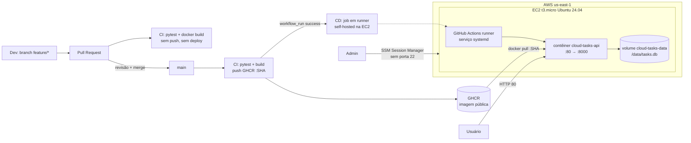
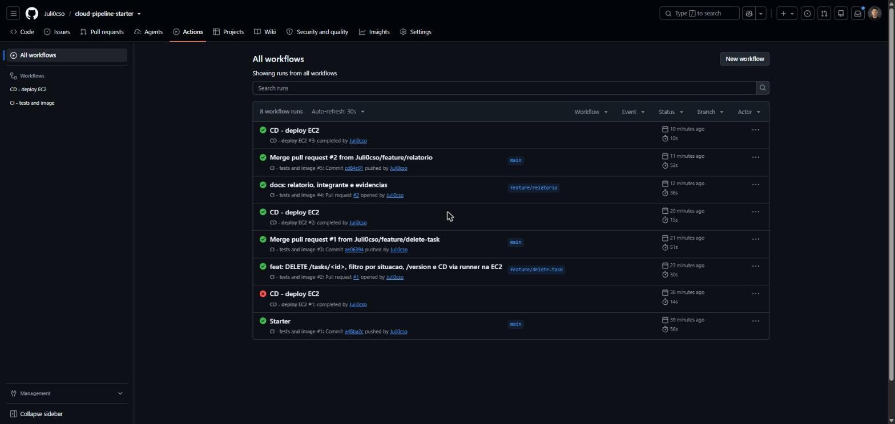
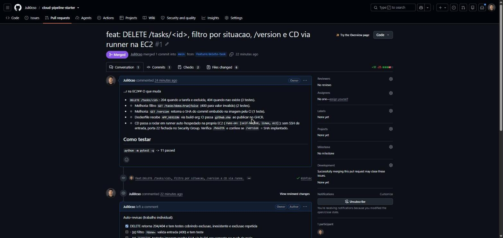
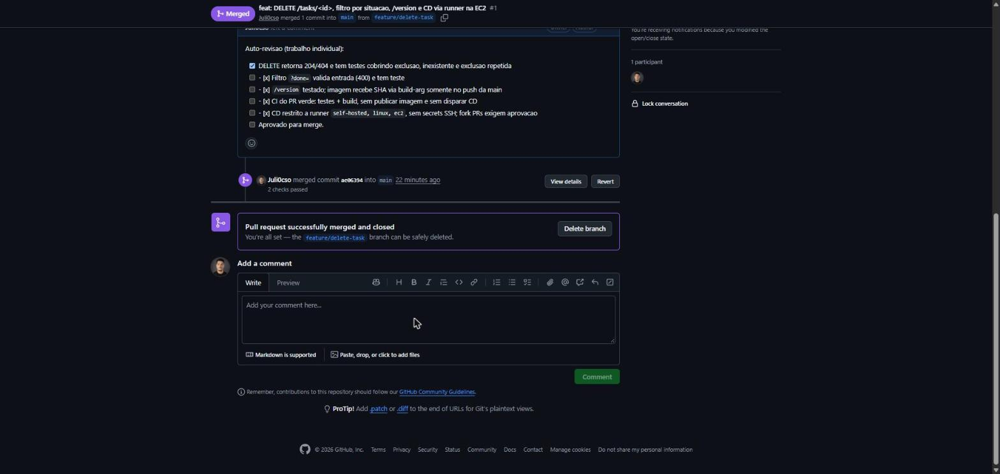
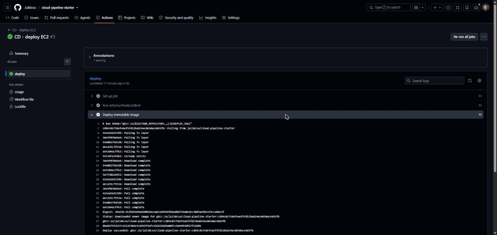
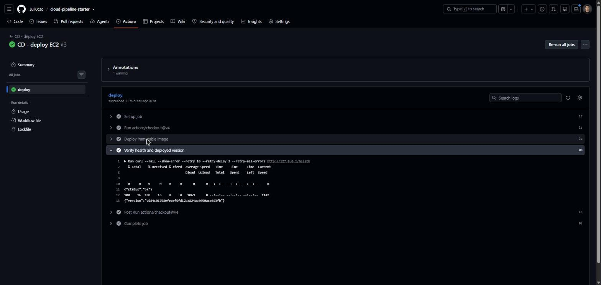
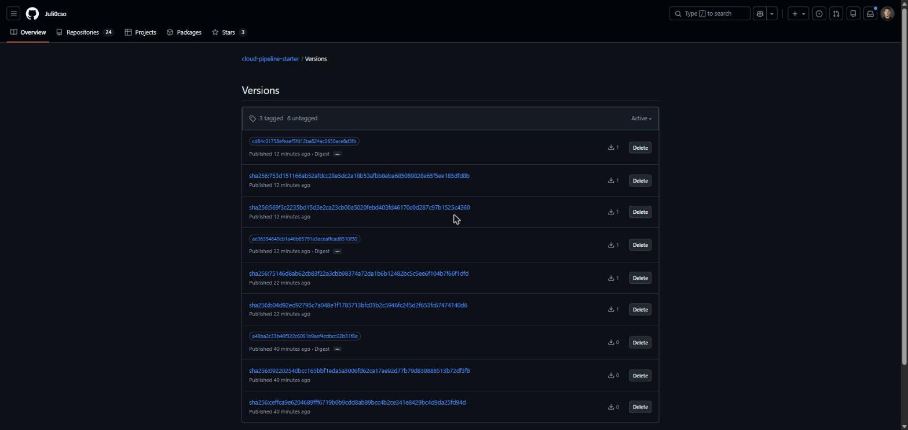
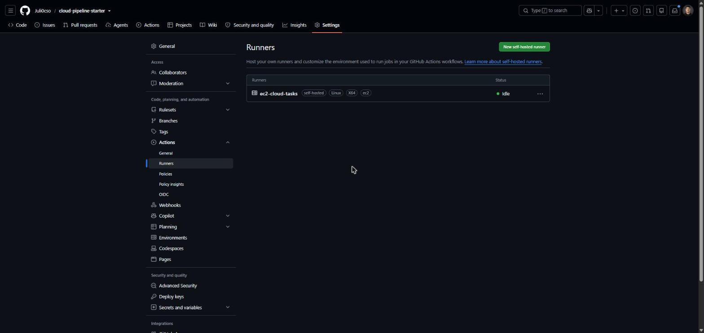
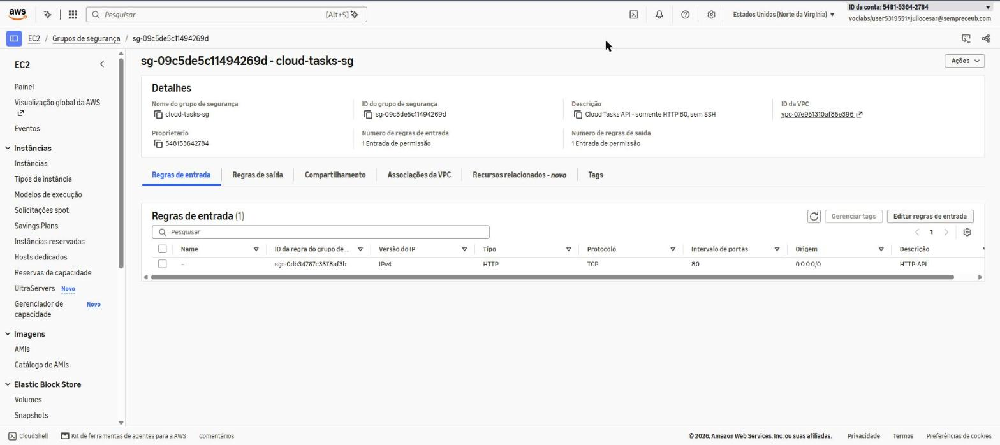
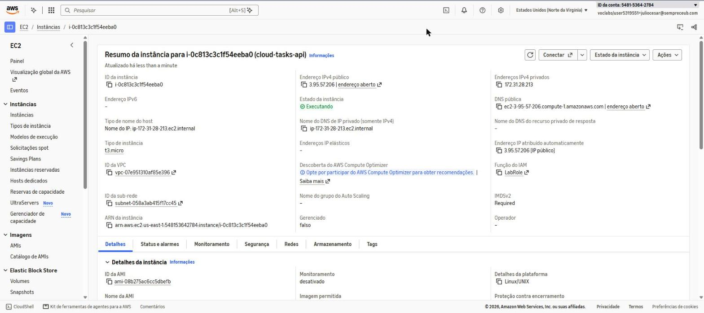

# Relatório — Esteira CI/CD Cloud Tasks API

## 1. Integrantes e distribuição de tarefas
| Nome | Matrícula | Responsabilidades |
|---|---|---|
| Júlio César Sousa Oliveira | 22308014 | Trabalho individual: repositório, CI, infraestrutura EC2, CD, endpoints/testes, relatório |

## 2. Links
| Item | Link |
|---|---|
| Repositório | https://github.com/Juli0cso/cloud-pipeline-starter |
| Aplicação | http://3.95.57.206/health · `/tasks` · `/version` (IP do Learner Lab; muda se o lab reiniciar) |
| Pull Request | https://github.com/Juli0cso/cloud-pipeline-starter/pull/1 |
| CI no PR (testes + build, sem publicar) | https://github.com/Juli0cso/cloud-pipeline-starter/actions/runs/43231358141 |
| CI na main (publicação GHCR) | https://github.com/Juli0cso/cloud-pipeline-starter/actions/runs/43231693591 |
| CD aprovado (1º deploy, PR #1) | https://github.com/Juli0cso/cloud-pipeline-starter/actions/runs/43231839786 |
| Imagem do 1º deploy | `ghcr.io/juli0cso/cloud-pipeline-starter:ae06394649cb1a46b85791a3aceaffcad8510f30` |
| Pull Request #2 (nova versão) | https://github.com/Juli0cso/cloud-pipeline-starter/pull/2 |
| CI no PR #2 | https://github.com/Juli0cso/cloud-pipeline-starter/actions/runs/43233094546 |
| CI na main (PR #2) | https://github.com/Juli0cso/cloud-pipeline-starter/actions/runs/43233291379 |
| CD aprovado (2º deploy, PR #2) | https://github.com/Juli0cso/cloud-pipeline-starter/actions/runs/43233444945 |
| Imagem do 2º deploy | `ghcr.io/juli0cso/cloud-pipeline-starter:cd84c01758efeaef5fd12ba824ac0650ace8d3fb` |

## 3. Arquitetura


O runner na EC2 abre uma conexão **de saída** (HTTPS) para o GitHub e busca jobs; não há conexão de entrada vinda do GitHub. Por isso o CD não precisa de SSH nem de secrets de chave privada.

## 4. Infraestrutura, rede e segurança
| Recurso | Configuração |
|---|---|
| Ambiente | AWS Academy Learner Lab, região us-east-1 (N. Virginia) |
| Instância | `cloud-tasks-api` (i-0c813c3c1f54eeba0), t3.micro, Ubuntu Server 24.04 LTS x86_64, EBS gp3 10 GB |
| Perfil IAM | `LabInstanceProfile` (permite acesso via AWS Systems Manager) |
| Security Group | `cloud-tasks-sg` (sg-09c5de5c11494269d) |
| Entrada | **somente TCP 80** (0.0.0.0/0) para a API HTTP. **Nenhuma regra para TCP 22**. |
| Saída | padrão (todo tráfego) — necessário para `docker pull` do GHCR e para o runner contatar o GitHub |
| Acesso administrativo | AWS Systems Manager Session Manager (via CloudShell `aws ssm start-session`) — sem SSH, sem chave |
| Contêiner | `cloud-tasks-api`, porta host 80 → contêiner 8000 (gunicorn), `--restart unless-stopped`, usuário não-root `appuser` |
| Persistência | volume Docker nomeado `cloud-tasks-data` montado em `/data` (SQLite `/data/tasks.db`) |
| Provisionamento | AWS CLI no CloudShell; *user data* instala `docker.io`, `curl` e adiciona `ubuntu` ao grupo `docker` |

### Decisão: runner auto-hospedado em vez de SSH
O workflow original fazia SSH a partir do runner hospedado do GitHub, que não tem IP fixo. Para funcionar seria preciso abrir a porta 22 para a internet, o que o enunciado proíbe. A solução adotada foi instalar o runner do GitHub Actions na própria EC2 (label `ec2`) e rodar o job de CD nele:
- porta 22 fechada; nenhum segredo de SSH armazenado no GitHub;
- funciona mesmo com o IP mudando a cada reinício do Learner Lab;
- o job de CD só roda via `workflow_run` de CI bem-sucedida em `push` na `main` (PRs nunca disparam deploy);
- mitigação de risco de repositório público: *Settings → Actions → "Require approval for all external contributors"* — PRs de forks não executam workflows sem aprovação do dono.

### Secrets e variáveis
Com o runner auto-hospedado, **nenhum secret é necessário**: a publicação no GHCR usa o `GITHUB_TOKEN` automático (`packages: write` só no job de imagem), e o deploy roda localmente na EC2. Environment `production` configurado para o job de CD. Nenhuma chave, token ou credencial está versionada.

## 5. Esteira
- **CI (`ci.yml`)** em `pull_request` e `push` na `main`: instala dependências, roda `pytest` (11 testes) e faz `docker build`. Login e `push` no GHCR só ocorrem quando `github.event_name == 'push'` (main), com tag = SHA completo do commit e `APP_VERSION` = SHA como build-arg.
- **CD (`cd.yml`)** disparado por `workflow_run` da CI, condicionado a `conclusion == success` e `event == push`: faz checkout do SHA, executa `scripts/deploy.sh ghcr.io/<repo>:<SHA>` (pull, recria contêiner com o mesmo volume, espera `/health`) e verifica que `/version` retorna exatamente o SHA implantado.

## 6. Evolução funcional (com testes)
| Mudança | Comportamento | Testes |
|---|---|---|
| `DELETE /tasks/<id>` | 204 sem corpo quando excluída; 404 se não existe | exclusão, id inexistente, exclusão repetida |
| Filtro `GET /tasks?done=true\|false` | lista só concluídas/pendentes; 400 para valor inválido | filtro true/false, valor inválido |
| `GET /version` | retorna o SHA do commit da imagem | versão configurada |

Total: 11 testes (5 originais + 6 novos), todos passando na CI.

## 7. Evidência de persistência
Executado na EC2 (via Session Manager) em 12/11/2026:
```
== antes:
[{"done":false,"id":1,"title":"teste persistencia"}]
cloud-tasks-api
== conteiner removido            # docker rm -f cloud-tasks-api
b0b38737c6a0...                  # docker run ... -v cloud-tasks-data:/data (mesma imagem)
cloud-tasks-api Up 4 seconds
== depois:
[{"done":false,"id":1,"title":"teste persistencia"}]
```
O contêiner foi destruído e recriado e a tarefa continuou existindo, pois o banco SQLite fica no volume `cloud-tasks-data`, fora do ciclo de vida do contêiner. Captura: `docs/evidencias/persistencia.png`.

A persistência também se manteve através de uma **troca de versão pelo CD** (merge do PR #2): o contêiner foi recriado com a nova imagem e a tarefa continuou lá.
```
{"status":"ok"}
{"version":"cd84c01758efeaef5fd12ba824ac0650ace8d3fb"}
[{"done":false,"id":1,"title":"teste persistencia"}]
cloud-tasks-api ghcr.io/juli0cso/cloud-pipeline-starter:cd84c01758efeaef5fd12ba824ac0650ace8d3fb Up 57 seconds
```
Captura: `docs/evidencias/segundo-deploy.png`.

## 8. Evidências
Capturas em `docs/evidencias/` (12/11/2026):

**Runs do GitHub Actions** — CIs de PR (sem publicar), CIs da main (publicação) e CDs; o CD #1 falhou com o workflow SSH original e foi corrigido no PR #1.


**PR #1 integrado** e **auto-revisão + merge com 2 checks aprovados**



**CD no runner da EC2** — `docker pull` da imagem pelo SHA e verificação de `/health` e `/version`



**GHCR** — imagens versionadas pelo SHA completo de cada commit da main


**Runner auto-hospedado** `ec2-cloud-tasks` (labels self-hosted, Linux, X64, ec2) online


**Security Group** `cloud-tasks-sg` — única regra de entrada: TCP 80 (sem porta 22)


**Instância EC2** `cloud-tasks-api` em execução (t3.micro, IP 3.95.57.206, função LabRole)


**Persistência** após recriar o contêiner e após o 2º deploy: ver seção 7.

## 9. Custos e encerramento
| Recurso | Preço de referência (us-east-1, sob demanda) | Observação |
|---|---|---|
| EC2 t3.micro | ~US$ 0,0104/h | só cobra com a instância ligada |
| EBS gp3 10 GB | ~US$ 0,08/GB-mês (~US$ 0,80/mês) | cobra mesmo com instância parada |
| IPv4 público | ~US$ 0,005/h | enquanto alocado |
| GHCR (pacote público) | gratuito | |

Gasto registrado no Learner Lab em 12/11/2026, após os dois deploys: **US$ 0,4 de US$ 50** (`docs/evidencias/10-learner-lab-custo.jpg`). _Atualizar no encerramento._ O Learner Lab desliga a instância ao fim de cada sessão de 4 h.

**Encerramento (após a apresentação):** terminar a instância `i-0c813c3c1f54eeba0` (EBS com *DeleteOnTermination*), excluir o Security Group `cloud-tasks-sg`, remover o runner em *Settings → Actions → Runners*. _[print do console sem recursos]_

## 10. Dificuldades e soluções
- **SSH a partir do runner hospedado:** sem IP fixo, exigiria porta 22 aberta para todos. Solução: runner auto-hospedado na EC2 + Session Manager.
- **IP muda a cada reinício do Learner Lab:** o CD não depende do IP (roda localmente na EC2); só a URL de acesso no relatório precisa ser atualizada.
- **Grupo `docker`:** só vale após novo login do usuário `ubuntu`; o runner foi instalado como serviço depois disso.
- **CD #1 falhou** (workflow original via SSH, sem secrets) — esperado; corrigido no PR #1.
