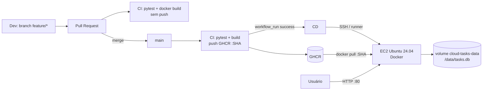

# Relatório — Esteira CI/CD Cloud Tasks API

## 1. Integrantes e distribuição de tarefas
| Nome | Matrícula | Responsabilidades |
|---|---|---|
| _preencher_ | | Repositório, CI, EC2, CD, endpoints, relatório |

## 2. Links
- Repositório: `https://github.com/USUARIO/REPO`
- Aplicação: `http://IP_PUBLICO/health` (disponível até: _data_)
- Pull Request: `https://github.com/USUARIO/REPO/pull/1`
- Run de CI aprovado (PR): _link_
- Run de CI aprovado (main, publicação GHCR): _link_
- Run de CD aprovado: _link_
- Imagem: `ghcr.io/usuario/repo:<SHA>`

## 3. Arquitetura

## 4. Infraestrutura e portas
| Recurso | Configuração |
|---|---|
| Instância | _tipo (ex.: t2.micro/t3.micro)_, Ubuntu 24.04 LTS x86_64, região _..._ |
| Security Group — entrada | TCP 80 de _origem_; TCP 22 somente de _meu IP/32_ (nunca 0.0.0.0/0) |
| Security Group — saída | padrão (todo tráfego) para `docker pull` do GHCR |
| Contêiner | `cloud-tasks-api`, porta host 80 → contêiner 8000, `--restart unless-stopped` |
| Persistência | volume Docker `cloud-tasks-data` montado em `/data` |
| Estratégia de deploy | _SSH a partir do runner / runner auto-hospedado / outra orientada pelo docente_ |

## 5. Segredos e variáveis (sem valores!)
- Secrets: `EC2_HOST`, `EC2_SSH_KEY`, `EC2_KNOWN_HOSTS`
- Variable: `EC2_USER = ubuntu`
- Environment: `production`

## 6. Evolução funcional
- `DELETE /tasks/<id>`: 204 quando excluída, 404 quando não existe (3 testes).
- Melhoria 1: filtro `GET /tasks?done=true|false` (400 para valor inválido) (2 testes).
- Melhoria 2: `GET /version` retorna o SHA do commit embutido na imagem pela CI (1 teste) — permite provar qual versão está implantada.

## 7. Evidência de persistência
1. `curl -X POST http://IP/tasks -H 'Content-Type: application/json' -d '{"title":"teste persistencia"}'`
2. `docker rm -f cloud-tasks-api` e novo deploy (ou nova versão via CD)
3. `curl http://IP/tasks` → a tarefa continua listada. _[screenshots]_

## 8. Evidências
_[prints: PR com checks verdes, run CI, run CD, pacote GHCR com tag SHA, /health, /version antes/depois de novo deploy, Security Group]_

## 9. Custos e encerramento
| Recurso | Período de uso | Custo estimado |
|---|---|---|
| EC2 _tipo_ | _datas_ | _US$ / free tier_ |
| EBS _GB_ | | |
| IP público | | |

Encerramento: instância terminada em _data_, volumes EBS excluídos, Elastic IP liberado (se usado), Security Group/key pair removidos. _[print do console sem recursos]_

## 10. Dificuldades e soluções
- _ex.: runner hospedado do GitHub não tem IP fixo → solução adotada: ..._
